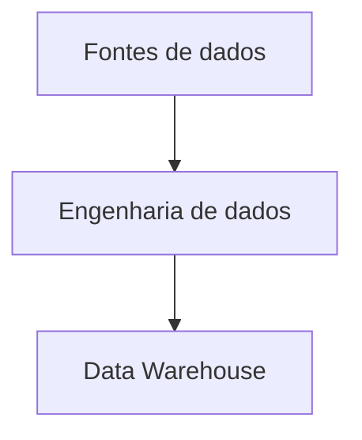

# MEDSIM — Inteligência Farmacêutica

Projeto de ciência de dados para investigar a disponibilidade de medicamentos no SUS: distribuição de estoques, riscos de vencimento, anomalias e padrões territoriais.

A proposta é construir isso como um projeto profissional, com metodologia científica, pipeline reproduzível, experimentos comparativos e documentação pública. Não começamos construindo uma aplicação bonita — começamos produzindo evidências.

## Perguntas de pesquisa

| Linha | Pergunta principal |
| --- | --- |
| Estoque | Como os medicamentos estão distribuídos nos estabelecimentos? |
| Validade | Quanto do estoque registrado está vencido ou próximo do vencimento? |
| Anomalias | Quais estabelecimentos apresentam padrões atípicos? |
| Território | Existem diferenças de disponibilidade entre municípios? |

O resultado será um conjunto de análises e modelos que ajudam a investigar problemas de abastecimento.

> **Limite da pesquisa:** a base representa registros enviados à BNAFAR, não necessariamente todo o estoque físico ou toda a disponibilidade de medicamentos do SUS. Cobertura, atualização e consistência precisam ser avaliadas antes de generalizar os resultados.

## Arquitetura

Linguagem central: **Python**. Armazenamento: **PostgreSQL**. Modelos NVIDIA Kumo como uma linha de experimentação.



## Setup

```bash
python -m venv .venv
source .venv/bin/activate
pip install -r requirements.txt
```

Principais dependências: `pandas`, `numpy`, `scikit-learn`, `geopandas`, `shapely`, `requests`.

## Estrutura do repositório

- `projeto.md` — proposta completa do projeto (perguntas, arquitetura, limites)
- `requirements.txt` — dependências do ambiente

## Status

Em construção. Próximos passos: ingestão das fontes BNAFAR, modelagem no PostgreSQL e primeiros experimentos das quatro linhas de investigação.
