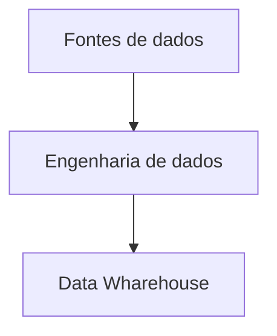

# MEDSIM - Inteligência farmacêutica

**Objetivo:** desenvolver uma solução analítica capaz de investigar a disponibilidade de medicamentos, identificar riscos de vencimento, detectar anomalias e compreender padrões territoriais de distribuição de estoques.

Minha proposta é construir isso como um projeto profissional de ciência de dados, com metodologia científica, pipeline reproduzível, experimentos comparativos e documentação pública.

Não vamos começar construindo uma aplicação bonita. Vamos começar produzindo evidências.

### Perguntas que o projeto deverá responder

O FarmaIntelligence terá quatro linhas de investigação:

| Linha | Pergunta principal |
| --- | --- |
| Estoque | Como os medicamentos estão distribuídos nos estabelecimentos? |
| Validade | Quanto do estoque registrado está vencido ou próximo do vencimento? |
| Anomalias | Quais estabelecimentos apresentam padrões atípicos? |
| Território | Existem diferenças de disponibilidade entre municípios? |

O resultado será um conjunto de análises e modelos que ajudem a investigar problemas de abastecimento.

**Limite da pesquisa:** a base representa registros enviados à BNAFAR, não necessariamente todo o estoque físico ou toda a disponibilidade de medicamentos do SUS. Precisamos avaliar cobertura, atualização e consistência antes de generalizar os resultados.

### Arquitetura técnica

Minha recomendação é usar Python como linguagem central, PostgreSQL como armazenamento e os modelos NVIDIA Kumo como uma linha de experimentação.

